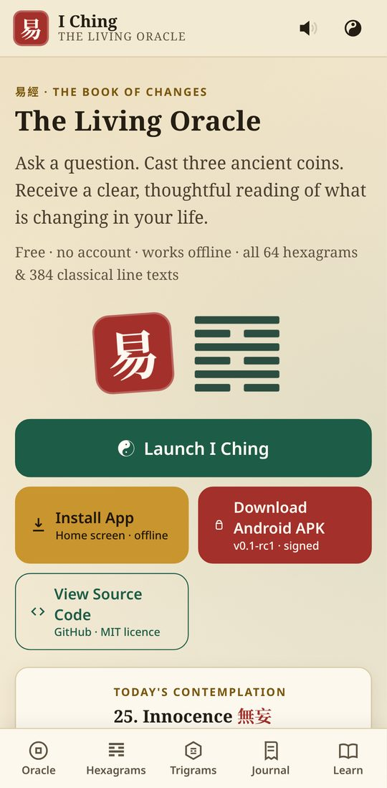
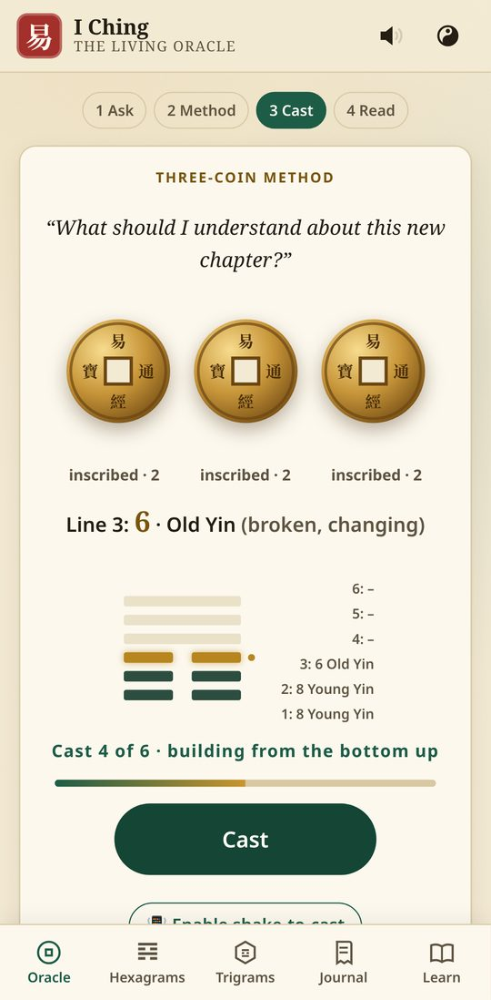
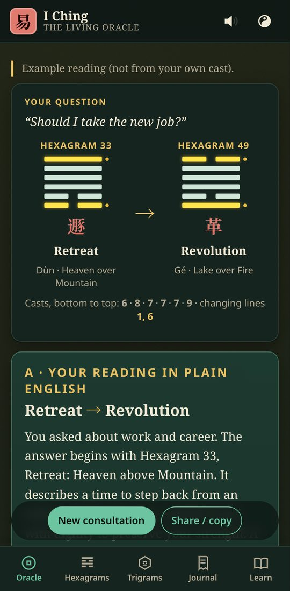
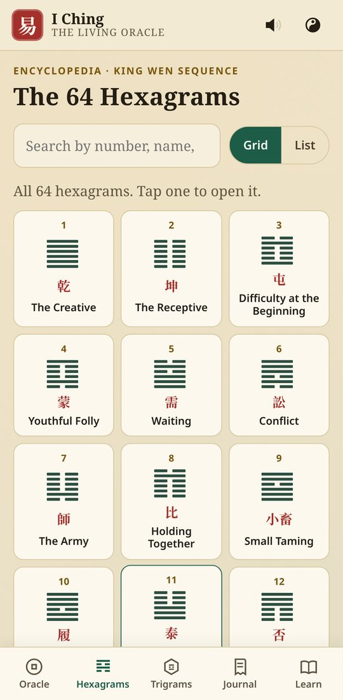
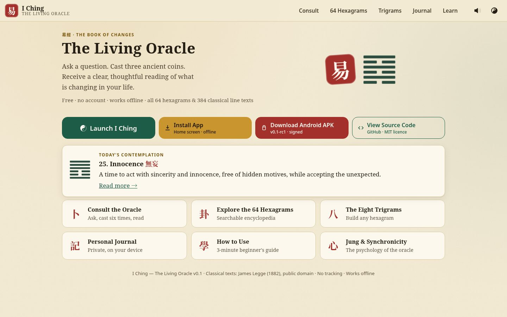

# 易 I Ching — The Living Oracle

Ask a question, cast three coins (or simulate the yarrow stalks), and receive a clear, thoughtful reading in plain English, with the classical text beside it. All 64 hexagrams and 384 line texts, a searchable encyclopedia, an interactive trigram builder, a private journal and an introduction to Jung's view of the I Ching. Free, no account, no tracking, works offline.

| | |
|---|---|
| **Open the website** | https://jalam1001.github.io/iching-living-oracle/ |
| **Install as an app (PWA)** | Open the website and tap **Install App** (or use your browser's *Install* / *Add to Home Screen*) |
| **Android APK** | [iching-living-oracle-v0.1-rc1.apk](https://github.com/Jalam1001/iching-living-oracle/releases/download/v0.1-rc1/iching-living-oracle-v0.1-rc1.apk) · [release notes & SHA-256](https://github.com/Jalam1001/iching-living-oracle/releases/tag/v0.1-rc1) |
| **Single-file version** | [iching-living-oracle-standalone.html](https://jalam1001.github.io/iching-living-oracle/iching-living-oracle-standalone.html) — save it and open it from disk, no server needed |
| **Testing report** | [docs/TESTING.md](docs/TESTING.md) |

<p>




</p>


## Features

- **Consult** — question → method → six animated casts (bottom to top) → reading. The coins shown always match the value cast.
- **Reading in seven parts** — A plain-English reading · B present situation · C changing lines · D where things may be heading · E practical guidance tailored to the question (work, relationships, family, health, money …) · F the traditional text (Legge 1882) · G a Jungian perspective.
- **64 Hexagrams** — grid or list, search by number, name, pinyin, Chinese or theme, full page for each hexagram with all six lines and a *transformation explorer* (flip any line to see where it leads).
- **Eight Trigrams** — interactive builder: choose upper and lower trigrams to form any hexagram.
- **Journal** — saved on your device (IndexedDB): notes, "what actually happened afterwards", search, recurring themes, export TXT/JSON, import, delete.
- **Learn** — How to Use (with an interactive demo), History & Philosophy, Jung & Synchronicity, How a reading is composed, Further Reading with checked links.
- Light and dark themes, optional ritual sounds and ambient music, shake-to-cast on phones, keyboard accessible, WCAG AA contrast.

## How the oracle works

| Line | Coins (2 = inscribed, 3 = plain) | Coins | Yarrow |
|---|---|---|---|
| 6 Old Yin (changing) | 2+2+2 | 1/8 | 1/16 |
| 7 Young Yang | 2+2+3 | 3/8 | 5/16 |
| 8 Young Yin | 2+3+3 | 3/8 | 7/16 |
| 9 Old Yang (changing) | 3+3+3 | 1/8 | 3/16 |

Randomness comes from `crypto.getRandomValues` with rejection sampling (no modulo bias). The yarrow method reproduces the exact odds of the traditional 49-stalk procedure by drawing from a bag of 16 marbles; it is a probability simulation, not a re-enactment of the ritual.

**Several changing lines** are interpreted with the convention of Zhu Xi (*Yixue Qimeng*, 1186): 1 line → that line; 2 → both, the upper predominant; 3 → the Judgments of both hexagrams; 4 → the two unchanging lines of the new hexagram, the lower predominant; 5 → the single unchanging line of the new hexagram; 6 → the Judgment of the new hexagram (Hexagrams 1 and 2 have their own special text). Other schools differ; the app says which rule it applies in every reading.

The reading is guidance for reflection, not prediction. Questions about health, money or legal matters get a reminder to consult a qualified professional.

## Sources

- Classical text: James Legge, *The Yî King* (Sacred Books of the East 16, 1882), public domain, via sacred-texts.com. Parsed by `tools/parse_legge.py` into `sources/legge_raw.json`.
- Plain-English readings, line interpretations and commentary: original writing for this project (`content/`).
- King Wen sequence verified against two independent references: Wikipedia's *List of hexagrams of the I Ching* (trigram composition) and Legge's NINE/SIX line labels.

## Project layout

```
www/            the app (vanilla HTML/CSS/ES modules) — served by Pages and packaged in the APK
  js/engine.js    casting, probabilities, hexagram lookup, changing-line rules
  js/reading.js   composes the seven-part reading
  js/app.js       UI and router; js/store.js journal; js/svg.js figures; js/audio.js sounds
  data/iching.json  generated database (64 hexagrams, 384 lines, 8 trigrams)
content/        plain-English source text (edited by hand)
tools/          build_db.py, parse_legge.py, make-icons.mjs, build-standalone.mjs, …
tests/unit      node:test — exhaustive engine and content tests
tests/e2e       Playwright — real-browser tests, screenshots, contrast audit
android/        Capacitor Android project
standalone/     single-file HTML build
docs/           TESTING.md, ANDROID.md, screenshots
```

## Develop

```bash
npm install
npm run build:data        # rebuild www/data/iching.json from content/ + sources/
npm test                  # unit tests
npx playwright install chromium && npm run test:e2e
npm run serve             # http://localhost:4173
npm run build:standalone  # standalone/iching-living-oracle.html
```

Android build: see [docs/ANDROID.md](docs/ANDROID.md).

## Licence

MIT for code and original writing. Legge's translation is in the public domain. See [LICENSE](LICENSE).
